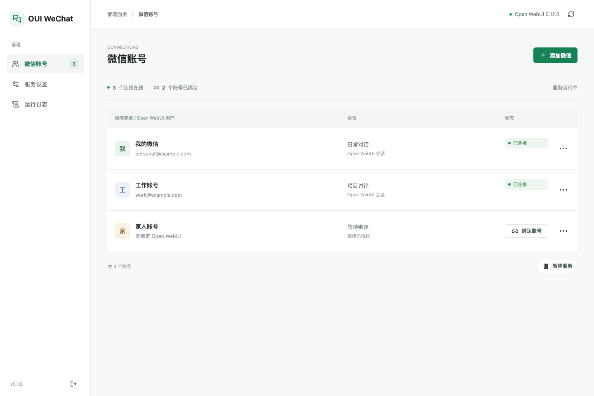

# OUI WeChat

把个人微信接入 Open WebUI，通过 Web 管理页完成扫码、账号绑定和服务配置。
微信对话保存到对应用户的 Open WebUI 会话，继续使用该用户的模型权限和记忆。



## 功能

- Web 管理：首次设置管理密码，之后在浏览器中管理账号、服务状态、显示选项和日志。
- 微信授权：网页显示二维码、自动更新过期二维码，支持在网页输入数字配对码。
- 图片双向收发：微信先发一张或多张图片，再发问题文字，合成一轮图文请求；
  OpenWebUI 附件、生成图和内嵌图片可以回传为微信图片消息。
- 多用户：每名微信使用者独立扫码，分别绑定自己的 Open WebUI 账号。
- 用户自助接入：管理员配置后端并开放用户登录后，朋友可用自己的 Open WebUI 邮箱和密码登录，
  扫码后自动绑定本人账号，只能查看和操作自己的微信，无服务设置与日志权限。
- 管理员保留全部微信的管理权限；Open WebUI 管理员使用用户入口登录时仍只有本站普通用户权限。
- 登录保护：按 IP、账号和全站限制尝试次数，返回重试倒计时；计数持久保存，重启不会重置。
- 真实会话：微信与其他客户端共享 Open WebUI 历史，每轮读取当前分支后续聊。
- 长期记忆：按 Open WebUI 的用户设置传递记忆开关，使用后端的记忆读取和写入能力。
- 默认显示思考状态提示，默认不发送思考正文；微信“正在输入”、工具状态、引用可分别配置。
- Web 绑定仅保存 JWT，不保存 Open WebUI 密码。令牌失效后可在网页更新登录。
- Docker 单服务部署，附带依赖锁和适配器源码，不依赖运行时 CDN 或额外克隆。

## Docker 部署

在仓库目录运行：

```sh
docker compose up -d --build
```

打开 `http://服务器地址:8787`，设置管理密码。
在“服务设置”填入 Open WebUI 地址，在“微信账号”添加微信并绑定 Open WebUI 账号。
需要朋友自行接入时，打开“允许 Open WebUI 账号登录”。朋友在登录页选择“Open WebUI 账号”入口，
使用其已有账号登录，再添加微信即可。本站不提供 Open WebUI 注册或找回密码。
之后的日常管理不需要命令行。飞牛可将仓库作为 Compose 项目导入后构建启动。

默认创建名为 `oui-data` 的持久数据卷，保存配置、微信授权、JWT 和管理密码哈希。
端口可通过 `.env` 中的 `OUI_PORT` 调整，完整部署说明见 [DEPLOY.md](DEPLOY.md)。

## 运行条件

- 微信有“设置 → 插件 → 微信 ClawBot”授权入口。每名使用者分别扫码授权。
- Open WebUI 开启密码登录，绑定的普通用户拥有可用模型及所需功能权限。
- 运行服务的机器能访问 Open WebUI 和微信 iLink。
- Open WebUI 地址必须能被适配器访问；容器中的 `127.0.0.1` 指向容器自身。

## 开发运行

需要 Python 3.11+ 和 uv：

```sh
uv sync --frozen
uv run oui-wechat --host 127.0.0.1 --port 8787
```

本地配置与凭据位于 `runtime/`，已从 Git 中排除。
打开 `http://127.0.0.1:8787` 使用同一管理界面。

```sh
uv run python scripts/validate.py --label local
uv run ruff check oui_wechat tests scripts validation
```

验证不需要真实微信或 Open WebUI 账号。另有开发探针可对真实实例进行隔离验收，
凭据从标准输入传入，不应写入命令参数、源代码或报告。

## 能力边界

- 已在 Open WebUI **0.12.0** 验证真实聊天保存、跨客户端续聊和记忆读写。
- 支持微信私聊文字和图片，不支持群聊、视频或普通文件投递。
- 图片严格采用先图后文：只发图时等待问题，纯文字不增加合并等待；
  先发文字后到达的图片留给下一轮文字，不追加到已经开始的请求。
- 默认等待 120 秒，从该批第一张图计时；每批最多 5 张、合计 25 MiB、单张 10 MiB，
  像素上限 4000 万。支持 JPEG、PNG、WebP，GIF 使用首帧。
- 普通会话把图文保存为同一条带附件的用户消息，支持网页查看与后续追问。
  临时会话使用内联图片，退出后清理本地临时历史。
- 回复中的外链图片保持文字，不自动下载；OpenWebUI 图片回传失败或超过限额时提示网页查看。
- 管理员可调整图片收发与大小限制；OpenWebUI 图像生成默认关闭，可在模型功能中允许，
  同时仍需后端和模型支持并授权。
- 思考提示依赖模型返回相应事件；不是每个模型或每轮对话都会出现。
- “正在输入”由微信客户端呈现，发送开关不代表所有客户端一定显示。
- 网页与微信同时向同一会话发送消息仍存在竞态；服务会拒绝接续尚未完成的回复。
- 工具以模型默认配置和账号权限为准，依赖浏览器执行或审批的功能不能完整复用。
- Web 服务禁用微信 `/login`、`/login-refresh`、`/logout`、`/relogin` 等凭据或改绑命令，
  统一在网页处理；附带上游的独立 CLI 仍保持原有行为。
- Web 登录令牌到期后需更新绑定，当前不保存密码做自动续签。
- 微信解绑、移除或授权过期不会抹掉归属；原用户可重新扫码，转交他人须由管理员重新绑定。
- iLink 与 Open WebUI 接口可能变化，版本升级后应重新验证。

## 微信图片使用

1. 在微信连续发送需要分析的图片。
2. 收到“已收到图片，请继续发送问题”后，发送问题文字。
3. 图片与问题一起交给当前模型；后续可继续追问。

图片下载、解密或上传失败时会保留该批至原截止时间，可重新发送问题重试。
启用图像生成的请求最长等待 30 分钟，允许工具长时间没有进度事件；普通文字仍沿用原超时。
生图请求从能力检查到图片回传期间，拒收该用户的新文字、图片和命令，不会排队或追加到下一轮；
只有 `/stop` 可主动停止。未启用生图的普通文字请求仍可排队，其他用户不受影响。
该保护针对整个启用生图的回合，即使模型最终没有调用生图工具，也需要等本轮结束后再发送。
切换模型保留待处理图片；新建/切换会话、改绑账号、解绑和 `/stop` 会清理待处理图片。
重启仅恢复未提交且未过期的图片；已开始网络提交的请求不会自动重放，
如果提交结果不明，需要重新发送图片。文字问题和队列不自动重放。

验证范围与未完成的部署检查见 [docs/VALIDATION.md](docs/VALIDATION.md)。

## 来源与许可

管理界面及新增服务代码采用 [MIT License](LICENSE)。
适配器基于 [Moha-Master/Open-WebUI-Weixin](https://github.com/Moha-Master/Open-WebUI-Weixin)，
附带于 `vendor/open-webui-weixin/`，保留作者信息、版本与本地修改记录。
第三方授权声明见 [THIRD_PARTY_NOTICES.md](THIRD_PARTY_NOTICES.md)。

提交前请保留 `.gitignore`，不要上传 `runtime/`、`.env`、日志、数据库或真实账号测试报告。
